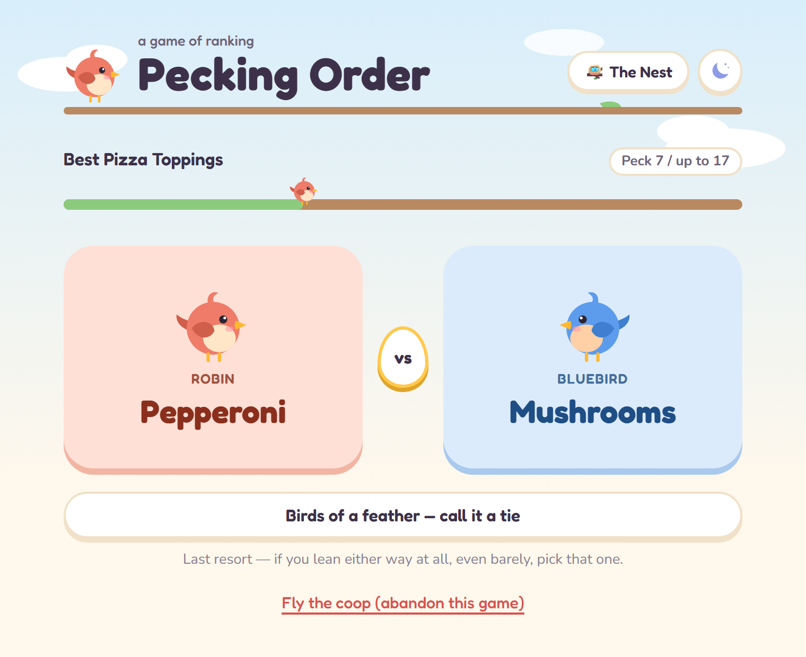
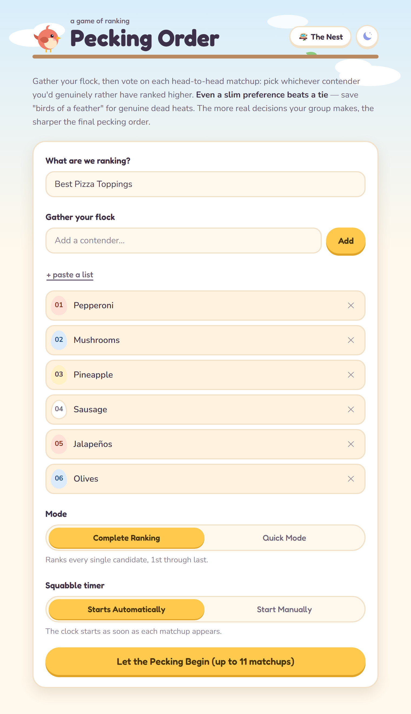
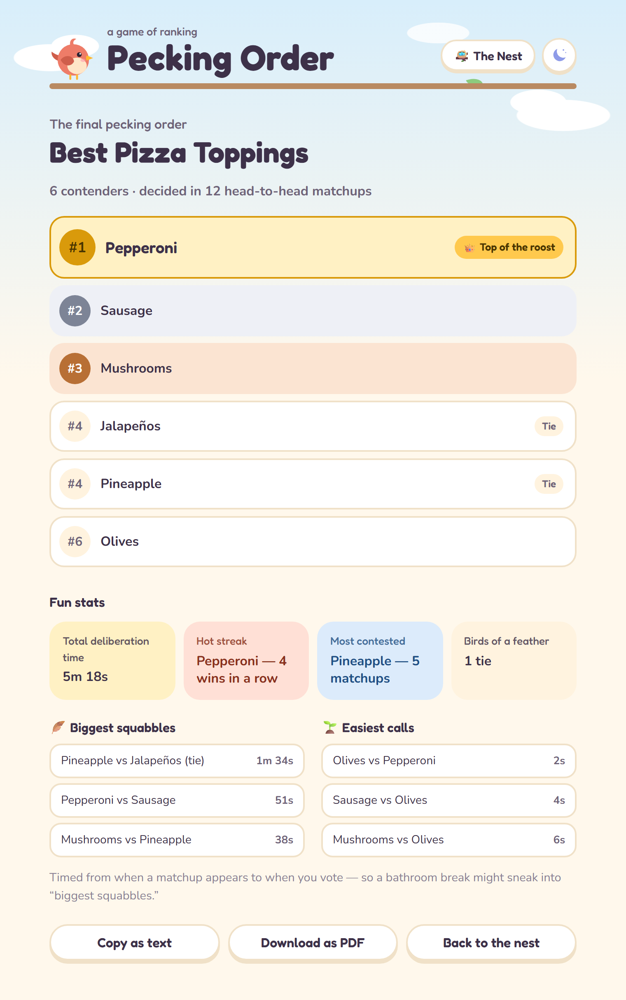
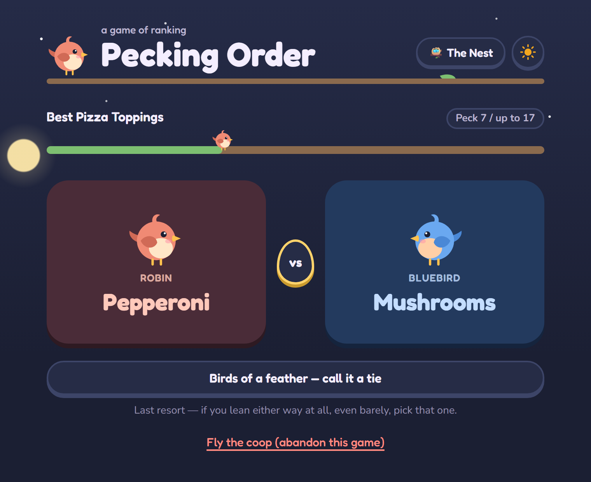

# Pecking Order

*A game of ranking.*


Gather a flock of anything (fruits, movies, pizza toppings, restaurants,
songs...), then settle its pecking order by voting on head-to-head matchups.
Two contenders face off, your group picks the one it likes more, and after a
handful of rounds you get a complete, numbered ranking of the whole list.

It's built for a group gathered around one screen, arguing it out. The birds
are just for fun: you can rank anything.



## Contents

- [Quick start](#quick-start)
- [How to play](#how-to-play)
- [Game options](#game-options)
- [Results and fun stats](#results-and-fun-stats)
- [Saving, resuming and The Nest](#saving-resuming-and-the-nest)
- [Light and dark themes](#light-and-dark-themes)
- [How the ranking works](#how-the-ranking-works)
- [Project layout](#project-layout)
- [Troubleshooting](#troubleshooting)
- [License](#license)

## Quick start

Everything runs on your own computer: no account, no hosting, and nothing is
sent anywhere. You only need **Python 3.9 or newer**. There's no Node, no
database server and no build step.

### 1. Get the code

With git:

```bash
git clone https://github.com/shanekdang/tier-tournament.git
cd tier-tournament
```

Without git: on the GitHub page, click **Code → Download ZIP**, unzip it,
and open a terminal inside the unzipped folder.

### 2. Install the one dependency (Flask)

```bash
pip install -r requirements.txt
```

<details>
<summary>Optional: install into a virtual environment instead</summary>

A virtual environment keeps Flask out of your global Python install.

```bash
python -m venv .venv
# Windows
.venv\Scripts\activate
# macOS / Linux
source .venv/bin/activate

pip install -r requirements.txt
```

Activate it again each time you open a new terminal to run the app.
</details>

### 3. Run it

```bash
python app.py
```

Then open **http://127.0.0.1:5000** in your browser. To stop the app,
press `Ctrl+C` in the terminal it's running in.

On some systems the commands are `python3` and `pip3` instead of `python`
and `pip`.

## How to play



### 1. Gather your flock

- **What are we ranking?** Give the game a name, like *Best Pizza Toppings*.
- **Gather your flock.** Add contenders one at a time (type a name and
  press **Enter** or **Add**). To add many at once, click **+ paste a list**
  and paste one name per line. Duplicates are skipped automatically, and
  you can remove anyone with the **✕** next to their name.
- Pick a **mode** and a **squabble timer** setting (see
  [Game options](#game-options)).
- Press **Let the Pecking Begin**. The button shows the maximum number of
  matchups your list could take.

You need at least two contenders. Your half-built list is remembered in the
browser, so refreshing the page won't lose it.

### 2. The pecking

Each round shows two contenders side by side: one on the **Robin** card and
one on the **Bluebird** card.

- **Click the card** of whichever contender your group likes more.
- **Birds of a feather — call it a tie** is for genuine dead heats only.
  Even a slight preference is more useful than a tie, so if you lean either
  way at all, pick that side.
- The bird hopping along the branch at the top shows how far through the
  game you are. The counter reads *Peck 7 / up to 17* because the real
  number of matchups is often lower than the maximum.
- **Fly the coop** abandons the game and throws away its progress.

Every vote is saved as soon as it's cast, so you can close the tab
mid-game and pick up later (see
[Saving, resuming and The Nest](#saving-resuming-and-the-nest)).

### 3. The final pecking order

When the last matchup is decided you get the full ranking, with the winner
crowned **Top of the roost** and the top three marked gold, silver and
bronze. Contenders you called a tie share a rank and are labeled **Tie**.
Below the ranking are some [fun stats](#results-and-fun-stats) about how
the game went.

From here you can:

- **Copy as text**: copies a numbered list to your clipboard, ready to
  paste into a group chat.
- **Download as PDF**: opens your browser's print dialog with a clean,
  printer-friendly layout. Choose **Save as PDF** as the printer.
- **Gather a New Flock**: go back and start another game.



## Game options

### Mode

| Mode | What you get | Matchups needed |
|---|---|---|
| **Complete Ranking** | Every contender ranked from 1st to last. | Roughly *n × log₂(n)*. About 25 for 10 contenders, about 70 for 20. |
| **Quick Mode** | Just the **Top 1**, **Top 3** or **Top 5**, in order. Everyone else is left unranked. | About *n − 1* to find 1st place, plus a few more for each extra place. Much faster for long lists. |

Use Quick Mode when you only care who wins: *"Which restaurant are we going to
tonight?"*

### Squabble timer

Every matchup is timed for the fun stats. This setting decides when the
clock starts.

- **Starts Automatically**: the clock starts as soon as the matchup appears.
  Good for quick, gut-feel decisions.
- **Start Manually**: the cards stay locked until you press
  **Let them squawk ▶**. Use this when you need to listen to two songs or
  watch two clips before deciding. The listening time isn't counted, so the
  stats only measure how long the group actually argued.

## Results and fun stats

The stats never affect the ranking. They just tell the story of the game.

| Stat | What it means |
|---|---|
| **Total deliberation / squabble time** | Time spent deciding, added up across every matchup. |
| **Hot streak** | The contender (or contenders) that won the most matchups in a row. Shown for streaks of 2 or more. |
| **Most contested** | The contender that showed up in the most matchups. |
| **Birds of a feather** | How many matchups were called a tie. |
| **Biggest squabbles** | The matchups that took longest to decide. |
| **Easiest calls** | The matchups that were decided fastest. |

With the automatic timer, the clock keeps running until someone votes, so
a snack break mid-matchup can show up in *Biggest squabbles*.

## Saving, resuming and The Nest

- **Resuming a game:** progress is saved after every vote. If you close the
  tab or stop the app mid-game, the start screen offers a **Resume** banner
  next time. Choose **Discard** instead to throw that game away. If you
  start a new game without finishing the old one, the banner offers the
  newest unfinished game.
- **The Nest** (🪺 button in the top right) lists every finished game, newest
  first. Click one to see its full results and stats again, or click **✕**
  to delete it.
- **Where the data lives:** everything is stored in a single SQLite file
  at `data/tournaments.db`, created automatically the first time you run
  the app. It's ignored by git, so your games stay on your machine.

## Light and dark themes

Click the 🌙 / ☀️ button in the top right to switch between a sunny daytime
sky and a starry night. By default the app follows your computer's light or
dark setting. Once you click the button, your choice is remembered in that
browser.

| Light | Dark |
|---|---|
|  |  |

## How the ranking works

A single-elimination bracket only finds one winner. A full round-robin,
where everyone faces everyone, needs *n × (n − 1) / 2* matchups, which is 190
for a list of 20.

**Complete Ranking** instead runs a **merge sort** in which your group plays
the part of the comparison function. Contenders start as solo "flocks" that
are merged two at a time. Each merge asks you to compare only the front
contender of each flock, so the app never asks about a pair whose order
already follows from earlier answers. The result is a full ranking in
roughly *n × log₂(n)* matchups.

**Quick Mode** starts with a knockout round. Each matchup eliminates its
loser, so crowning 1st place always takes exactly *n − 1* matchups. To find
2nd place, only contenders who lost *directly to the winner* are still in
the running; anyone else lost to someone who wasn't 1st. That small group
plays a mini-knockout, and the same trick repeats for each further place.

**Ties:** a tie places both contenders next to each other in the order, and
if they end up adjacent in the final ranking they share a rank (1, 2, 2, 4…).

## Project layout

```
app.py                Flask routes and JSON API
tournament.py         Ranking engines (Tournament and QuickTournament);
                      plain Python with no web code, easy to test on its own
stats.py              Fun stats computed from the vote log
storage.py            SQLite persistence (creates and migrates the database)
templates/index.html  The page, plus the inline SVG bird used throughout
static/app.js         Frontend logic (talks to the API with fetch)
static/style.css      Styling, light/dark theme colors and animations
static/favicon.svg    Browser tab icon
docs/                 Screenshots used in this README
data/                 SQLite database (created on first run, gitignored)
```

## Troubleshooting

- **`python` or `pip` isn't found:** make sure Python 3.9+ is installed and
  on your `PATH` (`python --version` should work). Try `python3` / `pip3`
  instead.
- **Port 5000 is already in use:** another program is using it (on macOS
  it's often AirPlay Receiver). Stop that program, or change the port in the
  `app.run(...)` call at the bottom of `app.py` and open that port instead.
- **The page looks unstyled or out of date after an update:** do a hard
  refresh (`Ctrl+Shift+R`, or `Cmd+Shift+R` on macOS) to bypass the
  browser cache.
- **Fonts look plain:** the Fredoka and Nunito fonts load from Google Fonts.
  Without an internet connection the app still works, but uses your system
  font.
- **Starting over with a clean slate:** stop the app, delete
  `data/tournaments.db`, and start it again. A fresh, empty database is
  created automatically.

## License

[MIT](LICENSE). Do whatever you'd like with it.
